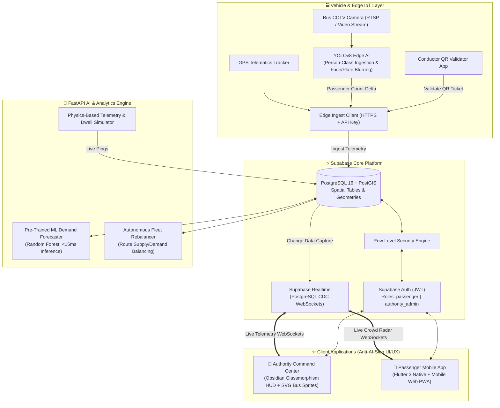
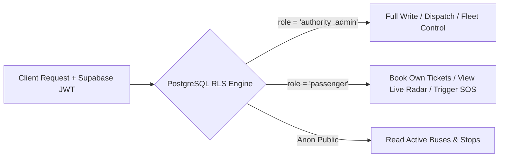

# 🏛️ BusSense AI 2.0: System Architecture & Technical Specifications

> **System Topology, Data Pipelines, PostGIS Models & Security Specifications**

---

## 🏗️ 1. End-to-End System Topology



---

## 🗄️ 2. PostGIS Spatial Architecture & Data Flow

### A. Route Geometries (`public.routes`)
Routes are stored as spatial `GEOMETRY(LineString, 4326)` representing the exact vehicular road corridor across Kerala (e.g. Route R1: Thampanoor ➔ Technopark via MG Road & NH 66).

```sql
-- Spatial Query: Find nearest bus stop to commuter within 500 meters
SELECT stop_name, route_number, 
       ST_Distance(location::geography, ST_SetSRID(ST_MakePoint(76.9366, 8.5241), 4326)::geography) AS distance_meters
FROM public.bus_stops
WHERE ST_DWithin(location::geography, ST_SetSRID(ST_MakePoint(76.9366, 8.5241), 4326)::geography, 500)
ORDER BY distance_meters ASC
LIMIT 1;
```

### B. Live Telemetry & 60fps Spline Interpolation
Each ping in `public.occupancy_telemetry` stores:
- `location`: PostGIS `Point(longitude, latitude)` with SRID 4326.
- `speed_kmh`: Current vehicle velocity used to calculate wheel rotation animation speeds.
- `heading_deg`: Gyroscopic azimuth (0–360°) used to rotate the SVG bus sprite along the driving direction.
- `crowd_tier`: Stored generated column (`GREEN` for &lt;50%, `YELLOW` for 50–80%, `RED` for &gt;80%).

---

## 🔐 3. Dual-Role Security & Row-Level Security (RLS) Model

Security is enforced at the database level using PostgreSQL Row-Level Security (RLS):



### Access Control Matrix:
1. **`public.buses` & `public.routes`**:
   - `SELECT`: Open to everyone (commuters and dispatchers).
   - `INSERT / UPDATE / DELETE`: Strictly restricted to `authority_admin`.
2. **`public.tickets`**:
   - `INSERT`: Commuters can book tickets assigned to their own `user_id`.
   - `SELECT`: Commuters view their own tickets; authority dispatchers/conductors can view all tickets on a bus route for ticket validation.
   - `UPDATE`: Only `authority_admin` can mark tickets as `'used'` or `'cancelled'`.
3. **`public.sos_alerts`**:
   - `INSERT`: Any authenticated or unauthenticated emergency caller can broadcast SOS.
   - `SELECT`: Broadcasts live to `authority_admin` and the creator.
   - `UPDATE`: Only `authority_admin` can mark alerts as `'investigating'` or `'resolved'`.

---

## ⚡ 4. Real-Time Telemetry Pipeline (Supabase Realtime CDC)

BusSense AI 2.0 completely eliminates inefficient HTTP polling.
1. When an edge YOLOv8 camera detects passenger changes or GPS updates, it inserts into `public.occupancy_telemetry`.
2. PostgreSQL writes to the Write-Ahead Log (WAL).
3. Supabase Realtime detects the Change Data Capture (CDC) event and broadcasts it over WebSockets to channel:
   ```javascript
   supabase
     .channel('fleet-radar')
     .on('postgres_changes', { event: 'INSERT', schema: 'public', table: 'occupancy_telemetry' }, payload => {
       updateBusMarkerSmoothly(payload.new);
     })
     .subscribe();
   ```
4. Connected Authority Dashboards and Passenger Mobile Apps update their visual SVG markers, radial occupancy dials, and alert banners in sub-100ms.
