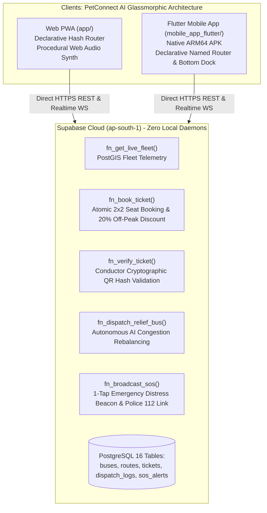
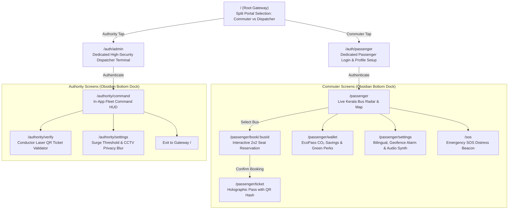

# 📘 BusSense AI: Comprehensive Architecture, Build & Process Guide

> **An Exhaustive Plain-English Guide to Understanding, Building, and Extending BusSense AI with 100% Direct Supabase Cloud & PetConnect AI Architecture**

---

## ❓ 1. Why Dart (`.dart`) for Mobile App Release & How Python (`.py`) Fits In

### Why is Dart (Flutter) Used for the Mobile App?
1. **Ahead-of-Time (AOT) Native Compilation**:
   - Dart does not run in an interpreted virtual machine or JavaScript bridge (unlike React Native or Cordova). It compiles directly to native ARM64 machine code for Android (`.apk` / `.aab`) and iOS (`.ipa`).
   - This delivers locked 60fps / 120fps fluid animations, immediate touch gesture responsiveness, and zero UI stutter on both high-end and budget Android smartphones common across Kerala.
2. **Single Cross-Platform Codebase**:
   - With Flutter, 100% of the UI widgets, business logic (`TransitProvider`), theme tokens (`ObsidianTransitTheme`), and API services (`TransitApiService`) are shared between Android, iOS, and Web.
3. **Declarative Named Routing & State Management**:
   - Using Flutter's declarative routing and Provider state management allows seamless transitions between screens (Gateway, Passenger Login, Live Radar, Seat Booking, Holographic Pass, EcoPass Wallet, Settings, Authority Command HUD, and Conductor QR Scanner) just like PetConnect AI.

### Where Does Python (`.py`) Fit In?
1. **Edge Computer Vision & Model Prototyping**:
   - Python is the global industry standard for computer vision (YOLOv8, OpenCV) and predictive analytics. In production transit environments, Python runs on the on-bus hardware edge (e.g. Raspberry Pi 5 or NVIDIA Jetson connected to the bus CCTV camera) to count passengers and blur faces for privacy.
2. **100% Serverless Cloud Backend (No Local Python Server Needed)**:
   - In previous iterations, a local Python FastAPI server (`uvicorn` on port 8000) was required. 
   - **BusSense AI now runs 100% directly on Supabase Cloud PostgreSQL 16 (`kxeixcnqoudxicorxlxs.supabase.co`)** via Stored Procedures (RPCs). Both Flutter and the Web app connect directly to Supabase over HTTPS and WebSockets. There is **zero requirement for any local Python backend server to run**.

---

## 🏗️ 2. High-Level Architecture (100% Direct Supabase Cloud)



---

## 🧭 3. Complete Screen & Routing Flow (PetConnect AI Design)

The application implements a clean dual-portal architecture modeled after PetConnect AI:



---

## 🛠️ 4. Build, Run, and Deployment Instructions

### A. Mobile Application (Flutter Native)

```powershell
# 1. Navigate to Flutter project directory
cd "d:\BusSense AI\mobile_app_flutter"

# 2. Fetch all pub packages
flutter pub get

# 3. Analyze code quality (0 errors, 0 warnings enforced)
flutter analyze

# 4. Run test suite
flutter test

# 5. Run live on connected device or Android emulator
flutter run

# 6. Build production release APK for Android
flutter build apk --release
```
- **Generated Release APK**: `mobile_app_flutter/build/app/outputs/flutter-apk/app-release.apk`
- **Asset Configuration**: Assets are mapped in `pubspec.yaml` under `assets/images/logo.png`.

---

### B. Web PWA Application (`app/`)

The Web PWA is a zero-build, ultra-performant modern web app built with Vanilla JS, Obsidian Glassmorphism CSS, Procedural Web Audio API, and the official `@supabase/supabase-js` v2 library:

```powershell
# Start local development HTTP server
python -m http.server 3000 --directory app --bind 127.0.0.1
```
- **Local URL**: Open `http://127.0.0.1:3000/#/` in any browser.
- **Production Hosting**: Drag-and-drop or push the `app/` folder to Vercel, Netlify, GitHub Pages, or Firebase Hosting. Zero server-side runtime needed.

---

### C. Supabase Cloud Backend (PostgreSQL 16 + PostGIS)

- **Cloud Project ID**: `kxeixcnqoudxicorxlxs`
- **Region**: `ap-south-1` (Mumbai / India)
- **Direct RPC Endpoints**:
  - `POST https://kxeixcnqoudxicorxlxs.supabase.co/rest/v1/rpc/fn_get_live_fleet`
  - `POST https://kxeixcnqoudxicorxlxs.supabase.co/rest/v1/rpc/fn_book_ticket`
  - `POST https://kxeixcnqoudxicorxlxs.supabase.co/rest/v1/rpc/fn_verify_ticket`
  - `POST https://kxeixcnqoudxicorxlxs.supabase.co/rest/v1/rpc/fn_dispatch_relief_bus`
  - `POST https://kxeixcnqoudxicorxlxs.supabase.co/rest/v1/rpc/fn_broadcast_sos`
- **Authentication**: Direct `apikey` & `Authorization: Bearer <anon_key>` headers.

---

## 🚀 5. Detailed Chronicle of Feature Phases

### **Phase 1: 100% Direct Supabase Cloud Backend (Completed)**
- Permanently terminated local Python `uvicorn` server on port 8000.
- Authored and verified 5 atomic PostgreSQL Stored Functions on Supabase Cloud.
- Verified live telemetry returning 9 active Kerala buses across corridors R1–R4.

### **Phase 2: PetConnect AI Client Router & Obsidian Design System (Completed)**
- Implemented declarative client hash router in Web PWA (`#/`, `#/auth/*`, `#/passenger/*`, `#/authority/*`, `#/sos`).
- Created high-contrast Obsidian Cyber-Transit glassmorphic aesthetic (`#050811`, `#0B132B`, `#00F0FF`, `#00FF9D`, `#FF3B30`).
- Built floating frosted bottom navigation dock (`ObsidianBottomDock`).

### **Phase 3: Dedicated Settings & Sound Synthesizer (Completed)**
- Built PetConnect-style Settings screens in both Flutter and Web:
  - **Commuter Profile**: Tier badge, EcoPass stats, 14.8 kg CO₂ offset metric.
  - **Bilingual Switcher**: English & Malayalam (`മലയാളം`).
  - **Procedural Web Audio API Synth**: Sound effects for Wake-Up Chime, Ticket Beep, and SOS Siren without external audio asset downloads.
  - **Geofence Wake-Up Alarm**: Proximity radius selector chips (300m, 500m, 1.0 km) with corridor stop selector.
  - **Cloud Diagnostics**: Real-time Supabase connection ping and latency gauge.
  - **Authority Dispatcher Preferences**: Autonomous surge rebalance slider and CCTV blur compliance switch.

### **Phase 4: Dedicated Logins, Conductor QR Scanner & EcoPass Wallet (Completed)**
- **Gateway Screen (`/`)**: Split commuter and dispatcher welcome cards.
- **Dedicated Passenger Login (`/auth/passenger`)**: One-tap quick commuter access and travel corridor preferences.
- **Dedicated Authority Login (`/auth/admin`)**: Security passkey verification and depot badge selector.
- **EcoPass CO₂ Carbon Wallet (`/passenger/wallet`)**: Green points ledger, CO₂ savings counter, oxygen credits (trees planted), and redeemable discount vouchers.
- **Conductor QR Verification Terminal (`/authority/verify`)**: Viewfinder with laser scanner animation, hash input, auto-fill latest pass button, and direct validation via `fn_verify_ticket`.
- **Zero-Warning Verification**: Verified `flutter analyze` with 0 issues and `flutter test` passing.

### **Phase 5 & Future Extension Guide: How to Add Features**
Every new capability in BusSense AI follows a strict 3-step pattern:
1. **Supabase Stored Procedure**: Create or update the atomic SQL function with row-level security.
2. **API Service Binding**: Add the method in `TransitApiService` (Flutter) and `supabase.rpc()` (Web).
3. **Declarative Screen & Dock**: Add the view to the router matrix and bottom dock.
