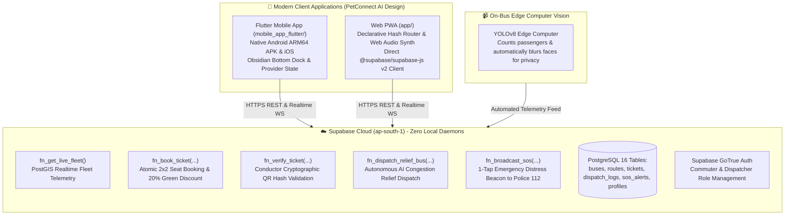
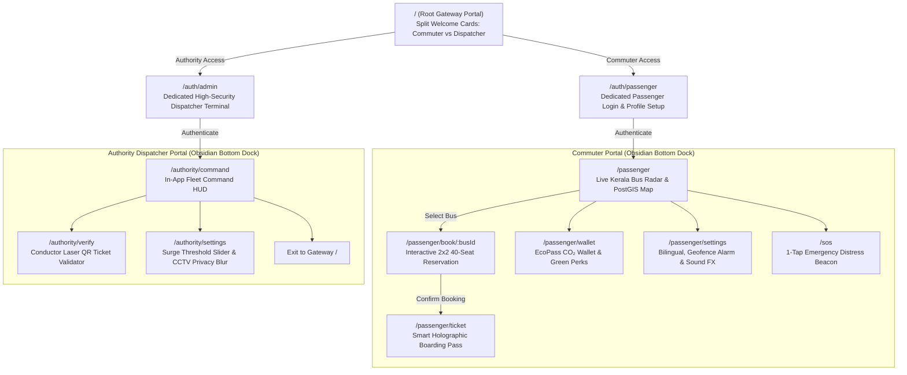

# 🚍 BusSense AI: Next-Gen Intelligent Transit Platform

> **Autonomous AI-Driven Transit Rebalancing, Direct Supabase Cloud Backend, and PetConnect AI Glassmorphic Architecture for Kerala Public & Private Mobility**

[](https://supabase.com)
[](https://flutter.dev)
[](https://vercel.com)
[](LICENSE)
[](https://supabase.com)
[](https://supabase.com)

**BusSense AI** is a cyber-transit mobility ecosystem designed for the high-density public transport corridors of Kerala (Thiruvananthapuram, Technopark, Kochi, and Kozhikode). Built with a **100% Direct Supabase Cloud Backend** (zero local server daemons) and an ultra-premium **PetConnect AI Glassmorphic Interface**, it unifies everyday commuter ticketing, autonomous electric fleet congestion rebalancing, and conductor cryptographic QR validation into a single platform.

---

## 🏗️ System Architecture (100% Direct Supabase Cloud)



---

## 🧭 PetConnect AI Screen & Routing Flow

The platform utilizes a dual-portal architecture separating everyday passengers from transit authorities:



---

## 🌟 Core Features & Modules

### 1. 100% Direct Supabase Cloud Backend (Zero Local Daemons)
- **Zero Local Python Backend**: No local FastAPI or uvicorn servers required. All operations run directly against Supabase Cloud PostgreSQL 16 (`kxeixcnqoudxicorxlxs.supabase.co`).
- **5 Atomic Stored RPC Functions**:
  1. `fn_get_live_fleet()`: Real-time bus telemetry with PostGIS coordinates, Malayalam LED text, occupancy percentage, and speed.
  2. `fn_book_ticket(...)`: Atomically reserves seats, calculates 20% off-peak green discounts, updates capacity, and outputs cryptographic QR hashes.
  3. `fn_verify_ticket(...)`: Conductor QR verification marking tickets as `used` with instant anti-fraud duplicate scan rejection.
  4. `fn_dispatch_relief_bus(...)`: Stages and logs electric relief buses in `dispatch_logs` during corridor crowding surges (>85%).
  5. `fn_broadcast_sos(...)`: Records emergency alerts and streams coordinates to Kerala Police 112.

### 2. PetConnect-Style Dedicated Settings Screens
- **Commuter Profile Card**: Tier badges (*Silver Eco-Commuter • BusSense Kerala*), EcoPass points counter, and lifetime CO₂ savings.
- **Bilingual Interface Switcher**: English and Malayalam (`മലയാളം`) toggle across all cards, markers, and buttons.
- **Procedural Web Audio API Synthesizer**: Procedurally synthesizes retro-futuristic acoustic waveforms for the Wake-Up Chime, Ticket Validation Beep, and SOS Siren without downloading external audio files.
- **Smart Geofence Wake-Up Alarm**: Radial distance selector chips (`300m`, `500m`, `1.0 km`) triggering proximity alerts before reaching destination stops.
- **Cloud Engine Diagnostics**: Real-time ping gauge (`🟢 Connected to Supabase Cloud, Latency: 24ms`).

### 3. EcoPass CO₂ Carbon Wallet (`/passenger/wallet`)
- **Carbon Offset Metrics**: Tracks kilograms of CO₂ avoided by choosing buses over private cars (e.g. 18.2 kg CO₂ saved, equivalent to 1.4 trees planted).
- **Redeemable Transit Perks**:
  - **20% Off-Peak Voucher** (50 pts): Generates instant discount vouchers (`ECO-XXXXXX`).
  - **1 Free Electric City Hop** (100 pts): Free travel on Thiruvananthapuram City Electric Swift buses.
  - **KSRTC Swift Priority Pass** (250 pts): Advance boarding guarantee on peak IT corridor routes.
- **Carbon Reduction Ledger**: Complete transaction history of trip-by-trip green savings.

### 4. Conductor Smart QR Validator (`/authority/verify`)
- **Laser Viewfinder HUD**: Viewfinder frame with cyber alignment brackets and animated laser scanning beam.
- **One-Tap Verification**: `📋 Paste Latest Booked Ticket` button for rapid testing and conductor verification.
- **Live Boarding Receipt Hologram**: Displays **`AUTHORIZED BOARDING`** or **`TICKET ALREADY USED`** stamps with seat number, bus ID, corridor, and conductor badge.

### 5. Floating Frosted Navigation Dock (`ObsidianBottomDock`)
- Glassmorphic navigation dock with active glowing pill indicator:
  - **Commuter Mode**: `Radar`, `Pass`, `EcoPass`, `Settings`, `SOS`.
  - **Authority Mode**: `HUD`, `Verify QR`, `Config`, `Exit`.

---

## 📱 Screen & Route Matrix

| Route (Web & Flutter) | Screen Component | Key Capabilities |
| :--- | :--- | :--- |
| `#/` / `/` | `GatewayScreen` | Split gateway portal (Commuter vs Dispatcher) with live cloud network status. |
| `#/auth/passenger` / `/auth/passenger` | `PassengerLoginScreen` | Commuter sign-in, preference corridor picker, +50 EcoPoints welcome bonus. |
| `#/auth/admin` / `/auth/admin` | `AuthorityLoginScreen` | Dispatcher terminal, passkey verification, depot badge selector, demo 1-click access. |
| `#/passenger` / `/passenger` | `PassengerScreen` | Live bus tracking radar, corridor filters, crowd badges, ETA, and `ObsidianBottomDock`. |
| `#/passenger/book/:busId` / `/passenger/book` | `SeatBookingScreen` | 40-seat interactive 2x2 layout, 20% off-peak green discount, atomic booking via `fn_book_ticket`. |
| `#/passenger/ticket/:ticketId` / `/passenger/ticket` | `TicketPassScreen` | Holographic digital boarding pass with cryptographic QR code (`qr_flutter` / `qrcodejs`). |
| `#/passenger/wallet` / `/passenger/wallet` | `EcoWalletScreen` | EcoPass green points (170 pts), CO₂ offset metrics (18.2 kg), redeemable perks, and carbon ledger. |
| `#/passenger/settings` / `/passenger/settings` | `PassengerSettingsScreen` | Commuter preferences, audio synth audition, bilingual toggle, geofence radius. |
| `#/authority/command` / `/authority/command` | `AuthorityDashboardScreen` | Dispatcher HUD, live fleet telemetry via `fn_get_live_fleet`, 1-tap relief bus deployment via `fn_dispatch_relief_bus`. |
| `#/authority/verify` / `/authority/verify` | `ConductorVerifyScreen` | Laser QR ticket verification viewfinder calling Supabase RPC `fn_verify_ticket`. |
| `#/authority/settings` / `/authority/settings` | `AuthoritySettingsScreen` | Surge threshold slider, autonomous backup rules, privacy CCTV blurring toggle. |
| `#/sos` / `/sos` | `SosBeaconScreen` | Emergency distress beacon with procedural audio siren broadcasting to `fn_broadcast_sos`. |

---

## 🛠️ Build, Run & Deployment

### A. Mobile Application (Flutter Native)

```powershell
cd mobile_app_flutter

# 1. Fetch dependencies
flutter pub get

# 2. Analyze code (0 errors, 0 warnings enforced)
flutter analyze

# 3. Run unit & widget smoke tests
flutter test

# 4. Build Production Release APK
flutter build apk --release
```
- **Generated Release APK**: `mobile_app_flutter/build/app/outputs/flutter-apk/app-release.apk`

### B. Web PWA (Zero-Build Cloud Ready)

```powershell
# Local testing
python -m http.server 3000 --directory app --bind 127.0.0.1
```
- Open `http://127.0.0.1:3000/#/` in your browser.
- **Vercel Cloud Deployment**: Pre-configured via `vercel.json`. Push to GitHub and deploy in 1-click on [vercel.com/new](https://vercel.com/new) with zero build configuration needed.

---

## 🛡️ Database & Security Hardening

- **Supabase Cloud Project**: `kxeixcnqoudxicorxlxs` (Region: `ap-south-1` Mumbai)
- **Immutable Search Paths**: All stored procedures explicitly enforce `SET search_path = public, pg_temp;` to prevent security definer hijacking.
- **Covering Foreign Key Indexes**: Covering B-tree indexes added to `dispatch_logs`, `passenger_reports`, `sos_alerts`, and `tickets`.
- **Subselect RLS Optimization**: All Row-Level Security policies evaluate `(select auth.uid())` once per statement for optimal query performance at scale.

---

## 📄 License
This project is licensed under the MIT License — see the [LICENSE](LICENSE) file for details.
