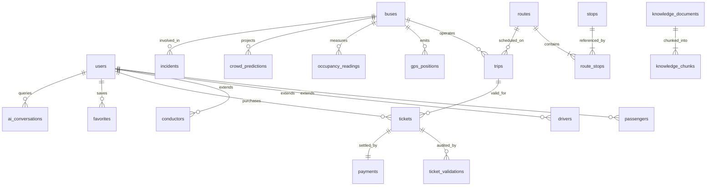

# BusSense AI — Data Model & Entity Relationships

This document outlines the entity-relationship architecture, schema design principles, and lifecycle diagrams governing the BusSense AI PostgreSQL database.

---

## 1. High-Level Entity Relationship Diagram

---

## 2. Core Relational Clusters

### Cluster 1: Identity & Profiles
- `users` is the root authentication entity.
- Role-specific sub-entities (`passengers`, `drivers`, `conductors`) maintain 1-to-1 relationships referencing `users(id)` via `ON DELETE CASCADE`.

### Cluster 2: Fleet & Corridors
- `routes` defines transit corridors (e.g., Kaloor ⇄ Infopark Phase 2).
- `stops` represents physical waypoints with WGS84 coordinates.
- `route_stops` acts as the junction table enforcing sequential ordering (`stop_sequence`), incremental distances (`distance_from_origin_km`), and travel time offsets.
- `buses` represents transit rolling stock, linking to `drivers` and `conductors`.

### Cluster 3: Live Telematics & Predictions
- `trips` connects a specific `bus` to a `route` for a scheduled journey run.
- `gps_positions` stores append-only spatial breadcrumbs (`lat`, `lng`, `speed`, `heading`).
- `occupancy_readings` captures edge-inferred passenger densities (`data_origin: CV_REPLAY` or `SIMULATED`) with unified crowd levels (`LOW < 50%`, `MODERATE 50–80%`, `CROWDED > 80%`).
- `crowd_predictions` records machine-learning forecasts produced by the Phase H9 Ridge forecasting engine across multi-horizon departure windows (NOW, +15m, +30m, +60m) stamped strictly with `data_origin: PREDICTION`.

### Cluster 4: Commerce & Anti-Fraud Auditing
- `tickets` captures digital transit passes, Base64 QR data URIs, and validity windows.
- `ticket_validations` logs conductor scan events, establishing an immutable audit trail to prevent pass reuse.
- `payments` records transaction settlement status.

### Cluster 5: Operational Intelligence & RAG
- `incidents` logs cockpit hazards and vehicle defects.
- `alerts` publishes passenger and operations dispatch notices.
- `knowledge_documents` and `knowledge_chunks`: In-memory vector-indexed knowledge repository managed by `KnowledgeIndexer` (`backend/app/services/knowledge_indexer.py`). Preserves chunk metadata (`chunk_id`, `document_id`, `section`, `content`, `source_type`, `applicable_route`, `access_scope`, `version`). Vector search operates via TF-IDF + cosine similarity fallback (`IMPLEMENTED / TFIDF_VECTOR_FALLBACK`).
- `reports` compiles periodic carbon offset and schedule adherence audits.

### Cluster 6: Multi-Factor Recommendations (Phase H10)
- `JourneyPlanResponse`: Multi-factor journey evaluation schema returned by `GET/POST /api/recommendations/plan`.
- `BusRecommendationItem`: Scored candidate transit options combining ETA, live occupancy, H9 Ridge predicted occupancy, duration, fare, and data quality rating.
- `crowd_predictions`: Asynchronous snapshot recording of +30m predicted load points for candidate buses with truth badging (`data_origin: PREDICTION`).

### Cluster 7: Realtime Streaming & Notifications (Phase H12)
- `notifications`: Persistent user-isolated notification inbox in Supabase with 15-minute deduplication hashing (`dedup_key`), read/unread state mutation, and strict cross-user isolation.
- `RealtimeEvent`: Standardized typed event envelope broadcast across WebSockets (`/ws/telemetry` for public fleet updates, `/ws/live` for role-authorized streams) and cached in an in-memory ring buffer (100 events) for polling fallbacks (`/api/realtime/events`).
- Event Types: `FLEET_TELEMETRY_UPDATE`, `TRIP_STATUS_UPDATE`, `OCCUPANCY_UPDATE`, `INCIDENT_UPDATE`, `ALERT_UPDATE`, `USER_NOTIFICATION`.
- Data Freshness: Real-time staleness monitoring with threshold evaluation (`is_stale: true` when telemetry age > 15s) and explicit truth labeling (`SIMULATED TELEMETRY`, `LIVE SENSOR TELEMETRY`, `CV REPLAY`, `MACHINE LEARNING PREDICTION`, `HUMAN-REPORTED INCIDENT`).
- Push Notification Abstraction: Honest provider interface reporting `delivery_status: DEFERRED` until physical Apple APNs / Google FCM server credentials are configured.

---

## 3. Schema Design Principles

1. **UUID Primary Keys:** All tables use `UUID` with `gen_random_uuid()` to prevent enumeration attacks and support distributed database sharding.
2. **Temporal Immutability:** Time-series tables (`gps_positions`, `occupancy_readings`, `ticket_validations`) are append-only.
3. **Data Provenance Badging:** Telemetry and prediction rows include a `data_origin` enum (`'LIVE'`, `'SIMULATED'`, `'PREDICTION'`, `'RECOMMENDATION'`, `'HUMAN_DECISION'`, `'CV_REPLAY'`, `'ESTIMATE'`).
4. **Row-Level Security (RLS):** All tables have RLS enabled, ensuring strict role isolation while permitting public read access to active vehicle telemetry.
