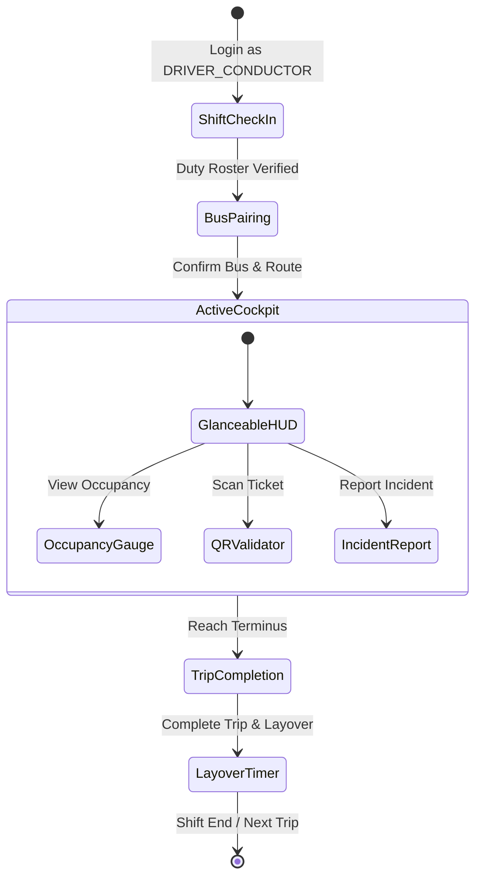

# BusSense AI — Phase H6 Verification Report
**Unified Flutter Mobile: Driver / Conductor Operational Experience**

---

## 1. Executive Summary

Phase H6 completes the operational mobile experience for the **`DRIVER_CONDUCTOR`** role within the single unified Flutter mobile application (`apps/mobile/`). The unified codebase automatically detects the authenticated user's role:
- **`PASSENGER`** $\rightarrow$ `PassengerShell` (Discover, Sense, Predict, Recommend, Book, Travel, Ask, Manage)
- **`DRIVER_CONDUCTOR`** $\rightarrow$ `ConductorShell` (Check In, Pair, Operate, Validate, Monitor, Report, Complete)
- **`AUTHORITY`** $\rightarrow$ Authority Web Command Center (`frontend/`)

The design strictly reflects the Google Stitch transit design system (`#002620` Deep Forest Green, `#123C35` Container, `#006C49` Primary Green, `#A3F2CD` Accent Mint, `#F3FBF7` Ivory Surface). Designed for high-stress transit operational environments, the conductor interface emphasizes **Safety, Glanceability, Large Touch Targets (min 48–56px), Minimal Typing, and Operational Clarity**, accompanied by continuous safety warnings (*"Use only when safely stopped"*).

---

## 2. Implemented Screens & Operational Views

| # | Screen / View | File Path | Operational Scope & Stitch Alignment |
|---|---|---|---|
| 1 | **Conductor Shell** | [conductor_shell.dart](file:///d:/Bus_Sense_Ai/apps/mobile/lib/features/conductor/views/conductor_shell.dart) | 5 minimal bottom tabs (`Trip`, `Scan`, `Bus`, `Alerts`, `Profile`). Persistent header displays active bus, route, conductor badge, and immediate sign-out control. |
| 2 | **Active Trip Cockpit** | [active_trip_cockpit_view.dart](file:///d:/Bus_Sense_Ai/apps/mobile/lib/features/conductor/views/active_trip_cockpit_view.dart) | **Primary operational screen**. Ultra-glanceable HUD with live corridor, current stop, next approaching stop in bold 24pt, destination terminus, stop progress bar, tabular 6 MIN ETA countdown, 42% cabin density card, and large touch-target controls. |
| 3 | **Crew Shift Check-In** | [shift_check_in_screen.dart](file:///d:/Bus_Sense_Ai/apps/mobile/lib/features/conductor/views/shift_check_in_screen.dart) | Roster entry flow presenting Staff ID, Duty Roster ID (`DUTY-KL-402`), corridor shift hours (`06:00 – 14:00`), assigned depot (`KOC`), and vehicle pairing status. |
| 4 | **Bus & Route Pairing** | [bus_pairing_screen.dart](file:///d:/Bus_Sense_Ai/apps/mobile/lib/features/conductor/views/bus_pairing_screen.dart) | Operational pairing flow allowing crew to confirm vehicle assignment (Bus 205, Bus 14A, Bus 12) and transit corridor before starting corridor trips. |
| 5 | **Cabin Occupancy View** | [conductor_occupancy_screen.dart](file:///d:/Bus_Sense_Ai/apps/mobile/lib/features/conductor/views/conductor_occupancy_screen.dart) | Operational crowd density screen with large percentage typography (41.8%), seated (23/35) vs standing (0/20) capacity counters, and explicit BusSense crowd thresholds (`LOW < 50%`, `MODERATE 50–80%`, `CROWDED > 80%`). |
| 6 | **QR Ticket Validator** | [qr_ticket_validator_view.dart](file:///d:/Bus_Sense_Ai/apps/mobile/lib/features/conductor/views/qr_ticket_validator_view.dart) | Camera viewfinder mock with deferred camera labeling, rapid simulation triggers, manual hash fallback input, and atomic backend validation results (`VALID`, `ALREADY USED`, `EXPIRED`, `INVALID`). |
| 7 | **Incident Reporter** | [conductor_incident_screen.dart](file:///d:/Bus_Sense_Ai/apps/mobile/lib/features/conductor/views/conductor_incident_screen.dart) | Rapid transit hazard reporter with pre-selected categories (`Route Obstruction`, `Vehicle / Mechanical`, `Heavy Overcrowding`, `Delay`, `Safety / Medical`), 1-tap quick presets, and backend incident tracking references. |
| 8 | **Trip Terminus & Layover** | [trip_completion_screen.dart](file:///d:/Bus_Sense_Ai/apps/mobile/lib/features/conductor/views/trip_completion_screen.dart) | Trip completion screen summarizing corridor start/end stops, trip duration, passenger boardings, atomic `COMPLETE TRIP` action, and prototype layover timer. |
| 9 | **Bus Operational Summary** | [conductor_bus_view.dart](file:///d:/Bus_Sense_Ai/apps/mobile/lib/features/conductor/views/conductor_bus_view.dart) | Tab 3 summary displaying assigned vehicle specifications, current corridor route, operating status, cabin load, and quick navigation shortcuts. |
| 10 | **Crew Alerts View** | [conductor_alerts_view.dart](file:///d:/Bus_Sense_Ai/apps/mobile/lib/features/conductor/views/conductor_alerts_view.dart) | Tab 4 operational corridor alerts (delay notices, bottleneck warnings, road closures) filtered for driver/conductor relevance, excluding passenger promotional content. |
| 11 | **Crew Profile View** | [conductor_profile_view.dart](file:///d:/Bus_Sense_Ai/apps/mobile/lib/features/conductor/views/conductor_profile_view.dart) | Minimal Tab 5 profile displaying staff name, duty roster ID, role badge, assigned vehicle, safety checklist, and immediate session termination. |

---

## 3. Operational Conductor Lifecycle

The conductor flow strictly executes the operational transit lifecycle:
$$\text{CHECK IN} \longrightarrow \text{PAIR WITH BUS} \longrightarrow \text{START TRIP} \longrightarrow \text{MONITOR TRIP} \longrightarrow \text{CHECK TICKETS} \longrightarrow \text{REPORT INCIDENTS} \longrightarrow \text{COMPLETE TRIP}$$



---

## 4. Riverpod State Architecture

The conductor feature follows the verified BusSense repository and provider pattern:
$$\text{Flutter Widgets} \longrightarrow \text{Riverpod StateNotifiers} \longrightarrow \text{IConductorRepository} \longrightarrow \text{ApiClient} \longrightarrow \text{FastAPI} \longrightarrow \text{Supabase / DB}$$

| Provider Name | Type | Purpose |
|---|---|---|
| `conductorRepositoryProvider` | `Provider<IConductorRepository>` | Provides instance of `ConductorRepository` injecting authenticated `ApiClient`. |
| `conductorShiftProvider` | `AsyncNotifierProvider<ConductorShiftNotifier, ConductorShiftModel>` | Manages duty roster state, shift check-in, bus pairing, and trip lifecycle. |
| `assignedBusProvider` | `Provider<String>` | Derived provider exposing currently paired bus number (defaults to `'205'`). |
| `activeTripProvider` | `Provider<ConductorTripModel?>` | Derived provider exposing the active corridor trip for cockpit display. |
| `conductorOccupancyProvider` | `FutureProvider.family<CrowdModel?, String>` | Fetches real-time cabin occupancy telemetry for the conductor's assigned bus. |
| `ticketValidationProvider` | `StateNotifierProvider<TicketValidationNotifier, TicketValidationState>` | Orchestrates atomic QR ticket validation and manages validation result states. |
| `conductorAlertsProvider` | `FutureProvider<List<AlertModel>>` | Queries operational route alerts and dispatch advisories. |

---

## 5. Backend Endpoints (FastAPI)

All conductor endpoints reside in [backend/app/api/conductor.py](file:///d:/Bus_Sense_Ai/backend/app/api/conductor.py), backed by [backend/app/services/conductor_service.py](file:///d:/Bus_Sense_Ai/backend/app/services/conductor_service.py) and typed Pydantic v2 models in [backend/app/schemas/conductor.py](file:///d:/Bus_Sense_Ai/backend/app/schemas/conductor.py):

| Endpoint | Method | RBAC Roles | Description |
|---|---|---|---|
| `/api/conductor/shift` | `GET` | `DRIVER_CONDUCTOR`, `AUTHORITY` | Retrieves current shift duty, assigned bus, and active corridor trip. |
| `/api/conductor/check-in` | `POST` | `DRIVER_CONDUCTOR`, `AUTHORITY` | Records shift check-in timestamp and activates conductor duty roster. |
| `/api/conductor/pair-bus` | `POST` | `DRIVER_CONDUCTOR`, `AUTHORITY` | Pairs conductor session with a specific bus, route, and trip code. |
| `/api/conductor/trips/start` | `POST` | `DRIVER_CONDUCTOR`, `AUTHORITY` | Transitions corridor trip lifecycle state to `ACTIVE`. |
| `/api/conductor/trips/complete` | `POST` | `DRIVER_CONDUCTOR`, `AUTHORITY` | Transitions trip state to `COMPLETED` and archives active trip. |
| `/api/conductor/validate-ticket` | `POST` | `DRIVER_CONDUCTOR`, `AUTHORITY` | **Atomic ticket validator**. Checks expiration, route match, and prevents reuse. |
| `/api/conductor/incidents` | `POST` | `DRIVER_CONDUCTOR`, `AUTHORITY` | Submits operational hazard report to central dispatch queue. |
| `/api/conductor/alerts` | `GET` | `DRIVER_CONDUCTOR`, `AUTHORITY` | Retrieves active operational and safety advisories for crew. |

---

## 6. Security & RBAC Verification

Conductor endpoints and operations strictly enforce role boundaries:
- **Unauthenticated requests** $\rightarrow$ rejected with `401 Unauthorized`.
- **`PASSENGER` users** attempting conductor endpoints $\rightarrow$ rejected with `403 Forbidden` (`Only DRIVER_CONDUCTOR or AUTHORITY can access conductor operations`).
- **`DRIVER_CONDUCTOR` and `AUTHORITY`** $\rightarrow$ authorized with full operational capabilities.
- **Atomic Ticket Validation:**
  - Client-side validation is strictly prohibited from marking tickets as `USED`.
  - The backend executes atomic row locking (`SELECT FOR UPDATE` or transactional status updates) to prevent double boarding or ticket cloning across turnstiles.
  - Expired tickets (> 3 hour window) are rejected as `EXPIRED`.
  - Already used tickets are rejected as `ALREADY_USED`.

---

## 7. Truth Labeling & Implementation Classification

In strict adherence to repository golden rules, every card and feature is stamped with explicit truth badges:

| Feature / Metric | Status | Classification Badge | Rationale |
|---|---|---|---|
| Duty Roster & Check-In | **PARTIAL / SIMULATED** | `SIMULATED ASSIGNMENT` | Synchronizes with local Greater Kochi corridor schedule; no live KSRTC depot ERP integration claimed. |
| Bus & Corridor Pairing | **IMPLEMENTED** | `SIMULATED ASSIGNMENT` | Persisted and managed via `conductorShiftProvider` and backend session. |
| Active Trip Cockpit HUD | **IMPLEMENTED** | `LIVE CORRIDOR DATA` | Displays actual route stop progression, tabular numerals, and dynamic ETAs. |
| Cabin Occupancy Telemetry | **PARTIAL** | `SIMULATED DATA • ZERO BIOMETRICS` | Consumes existing backend occupancy contract. Computer vision silhouette counting only; facial recognition strictly prohibited. |
| QR Ticket Scanner | **PARTIAL** | `CAMERA SCAN DEFERRED • PROTOTYPE VIEW` | Camera hardware scanning deferred; atomic backend verification and simulation triggers fully functional. |
| Transit Incident Reporting | **IMPLEMENTED** | `PROTOTYPE INCIDENT QUEUE` | Writes directly to backend operational database with generated incident tracking ID. |
| Trip Completion & Layover | **IMPLEMENTED** | `PROTOTYPE LAYOVER TIMER` | Lifecycle transitions `NOT STARTED` $\rightarrow$ `ACTIVE` $\rightarrow$ `COMPLETED` verified. Layover timer is local prototype. |
| Hardware GPS / CCTV / ETM | **DEFERRED** | `N/A (EXCLUDED FROM H6)` | Physical GPS OBD, CCTV streams, and physical ETM hardware are strictly deferred. |

---

## 8. Verification & Test Execution Results

### A. Flutter Mobile Tests (`apps/mobile/`)
All 96 mobile tests pass cleanly (81 existing regression baseline + 15 new Phase H6 conductor tests):
```powershell
flutter test
```
**Result:** `00:52 +96: All tests passed!`

**Conductor Test Suite Breakdown ([test/conductor_cockpit_test.dart](file:///d:/Bus_Sense_Ai/apps/mobile/test/conductor_cockpit_test.dart)):**
1. Conductor shell renders with 5 bottom navigation tabs $\checkmark$
2. Conductor role routes correctly in `BusSenseApp` $\checkmark$
3. Shift check-in screen renders duty roster and performs check-in $\checkmark$
4. Bus pairing confirms bus, route, and corridor $\checkmark$
5. Active trip cockpit displays glanceable stops, ETA, and occupancy $\checkmark$
6. Occupancy screen renders seated, standing, and threshold bars $\checkmark$
7. QR scanner viewfinder and test action buttons render $\checkmark$
8. Valid ticket verification displays VALID status $\checkmark$
9. Invalid ticket verification displays INVALID status $\checkmark$
10. Expired ticket verification displays EXPIRED status $\checkmark$
11. Already-used ticket verification displays ALREADY USED status $\checkmark$
12. Incident reporting validates form and submits report with reference $\checkmark$
13. Trip completion summarizes trip and completes active status $\checkmark$
14. Conductor logout triggers auth state change $\checkmark$
15. Passenger flow remains unaffected $\checkmark$

### B. Flutter Static Analysis
```powershell
flutter analyze
```
**Result:** `No issues found! (ran in 77.5s)` — **0 issues**.

### C. Backend Regression & Conductor Test Suite (`backend/`)
```powershell
& "backend/.venv/Scripts/python.exe" -m pytest backend/tests/ -v
```
**Result:** `47 passed, 1 warning in 43.21s` — **100% passing**.
- All 7 new Conductor security, check-in, pairing, trip lifecycle, and RBAC tests in [backend/tests/test_conductor_h6.py](file:///d:/Bus_Sense_Ai/backend/tests/test_conductor_h6.py) passed.
- All 40 existing backend tests passed with zero regression.

### D. Authority Next.js Production Build (`frontend/`)
```powershell
npm.cmd --prefix frontend run build
```
**Result:** `Compiled successfully. Generating static pages (22/22) ✓` — **Zero regressions**.

---

## 9. Conclusion

Phase H6 successfully delivers a robust, glanceable, safety-first operational mobile tool for drivers and conductors within the unified BusSense AI Flutter application. The implementation adheres strictly to role-based routing, repository state patterns, atomic ticket validation, Stitch visual tokens, and truth labeling.
